# Glwadys Dalleau — Portfolio

Un portfolio éditorial immersif autour de **THE EDIT** : réserver, tirer, annoter, caler, transmettre. Direction visuelle chaleureuse et précise, projets présentés avec leur contexte, et expérience mobile composée spécifiquement plutôt que simplement réduite.

**Statut : version V14 en cours de revue.** Les captures ci-dessous sont de vrais rendus du site en production locale (8 octobre 2026), pas des maquettes. Les vérifications techniques ont réussi, mais le jury créatif indépendant n'a **pas encore accordé de validation finale / « 100 % »**. Cette page sera mise à jour avec les captures de la version finale validée.

**Branche de travail :** `jarvis/awwwards-rebuild` — ne pas confondre avec `main`. Aucune mise en production publique n'est impliquée par ce dépôt.

## Galerie desktop et mobile

Toutes les captures sont enregistrées **dans le dépôt**, afin de rester accessibles plus tard depuis GitHub. Cliquez sur une image pour l'ouvrir en grand.

| Étape | Desktop · 1440 × 900 | Mobile · 390 × 844 |
| --- | --- | --- |
| **01 — Hero** | [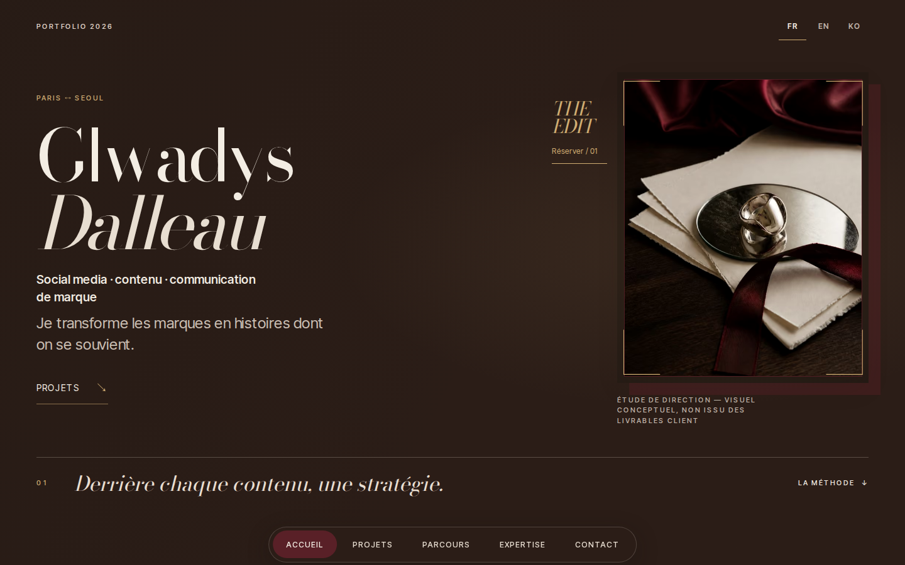](docs/previews/desktop-hero.png) | [](docs/previews/mobile-hero.png) |
| **02 — Réserver** | [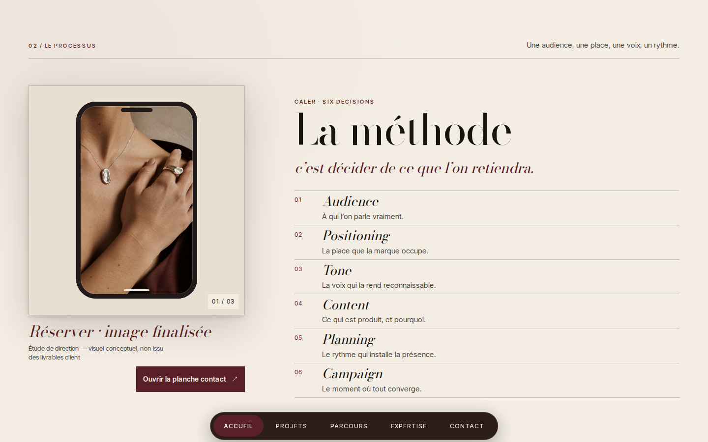](docs/previews/desktop-edit0.png) | [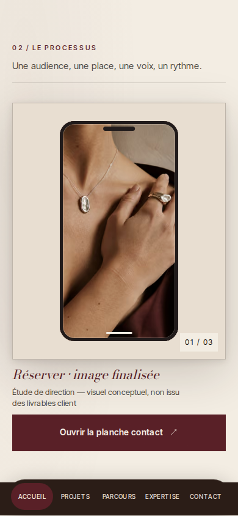](docs/previews/mobile-edit0.png) |
| **03 — Tirer** | [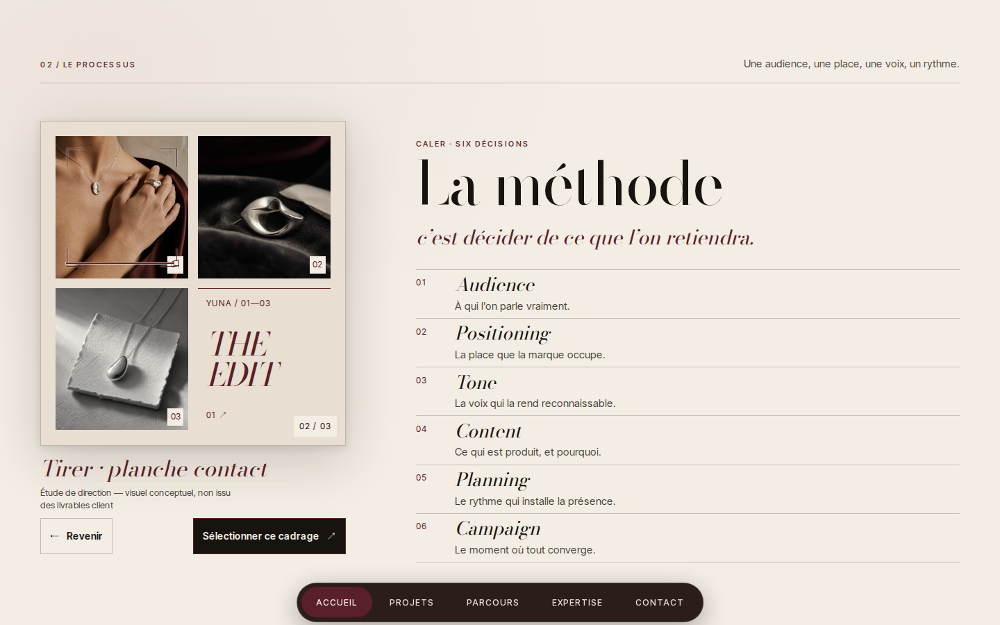](docs/previews/desktop-edit1.png) | [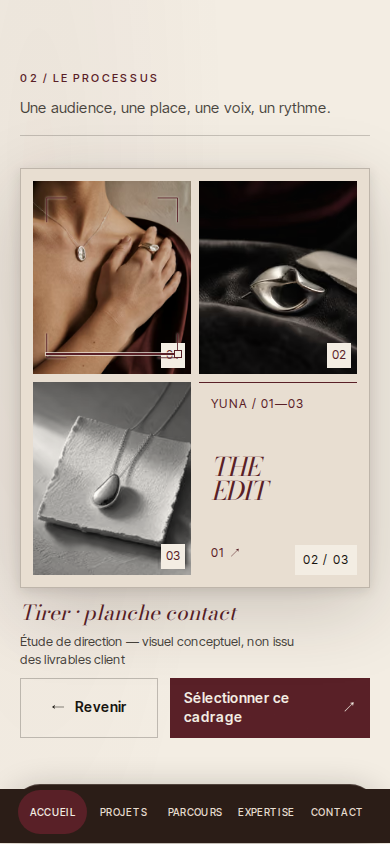](docs/previews/mobile-edit1.png) |
| **04 — Annoter** | [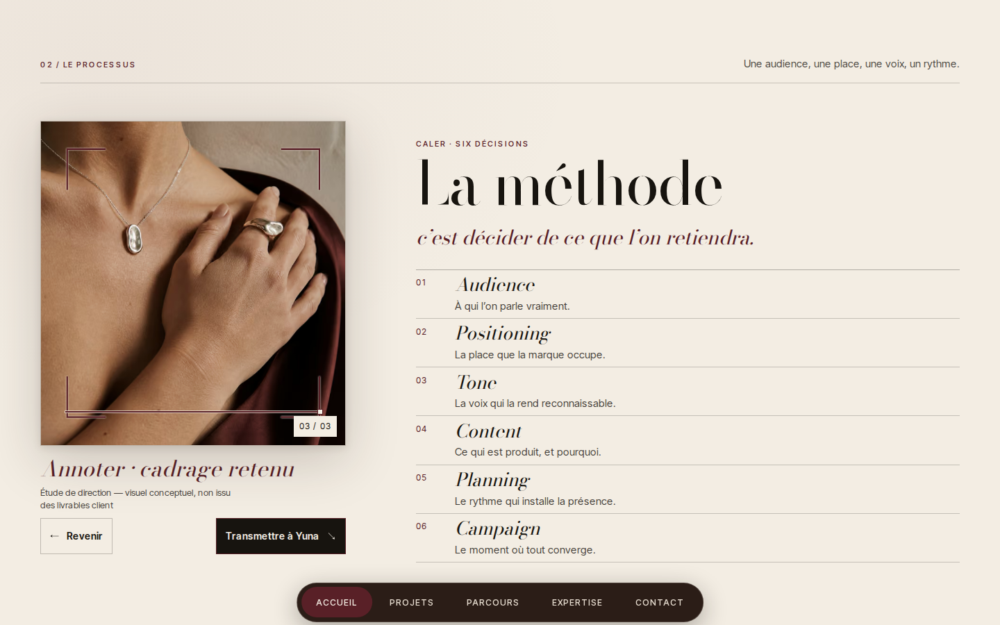](docs/previews/desktop-edit2.png) | [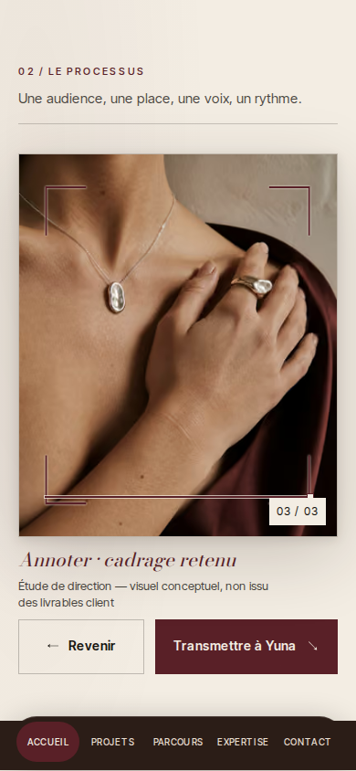](docs/previews/mobile-edit2.png) |
| **05 — Transmettre vers Yuna** | [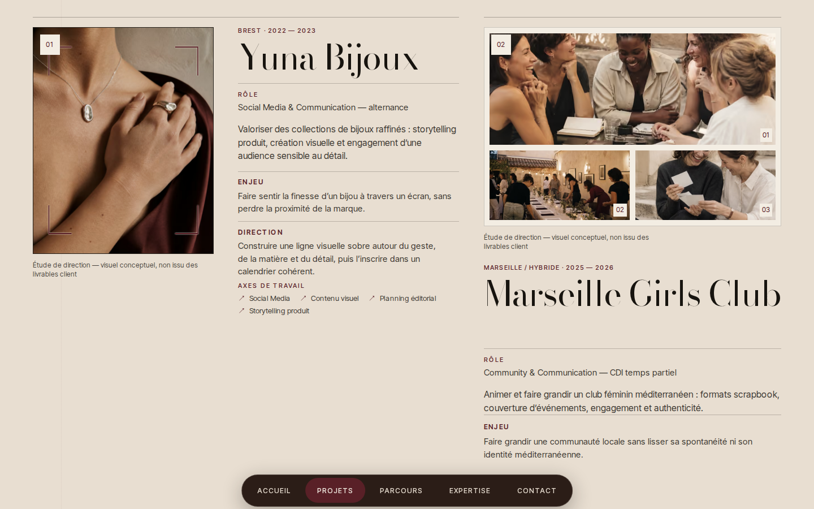](docs/previews/desktop-handoff.png) | [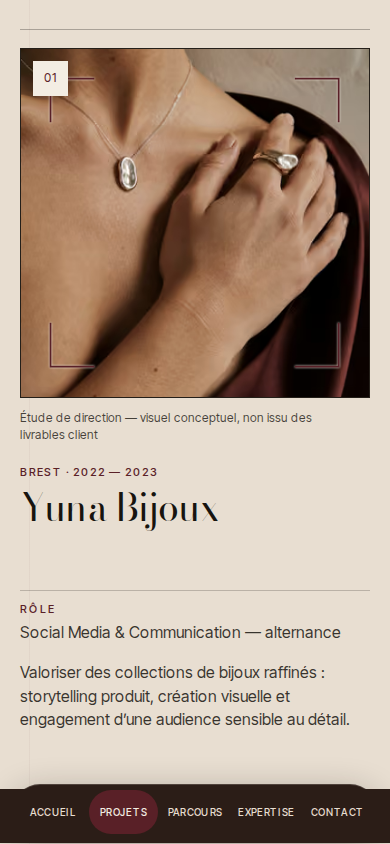](docs/previews/mobile-handoff.png) |
| **06 — Projets** | [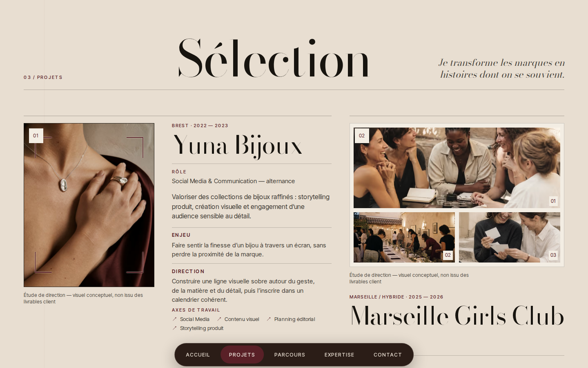](docs/previews/desktop-work.png) | [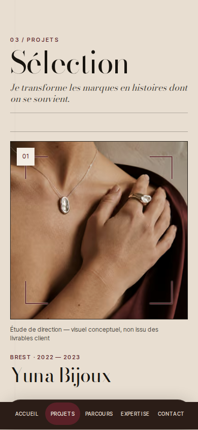](docs/previews/mobile-work.png) |
| **07 — Parcours** | [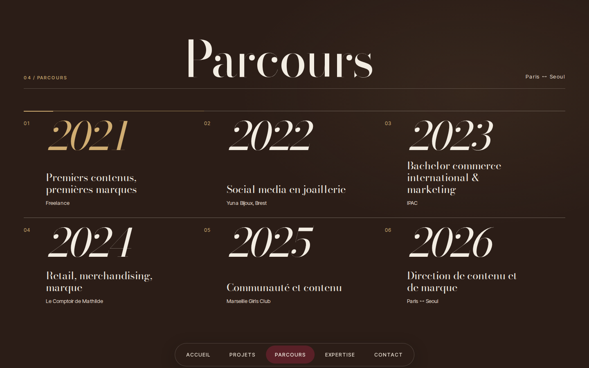](docs/previews/desktop-journey.png) | [](docs/previews/mobile-journey.png) |
| **08 — Expertise** | [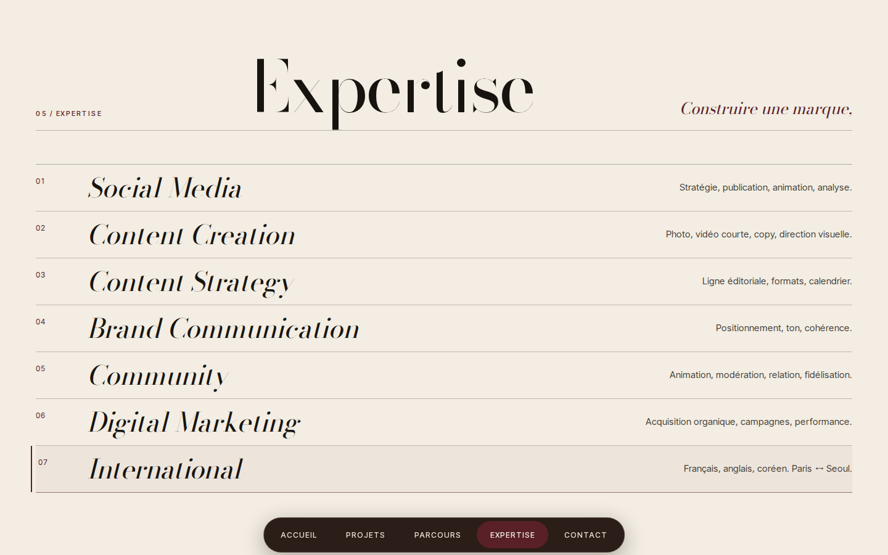](docs/previews/desktop-expertise.png) | [](docs/previews/mobile-expertise.png) |
| **09 — Contact** | [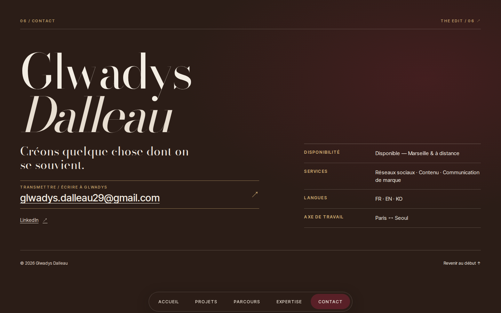](docs/previews/desktop-contact.png) | [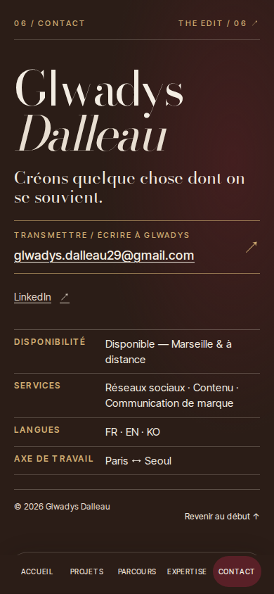](docs/previews/mobile-contact.png) |

### Petits iPhone · 320 × 800

[](docs/previews/iphone-320-hero.png)
[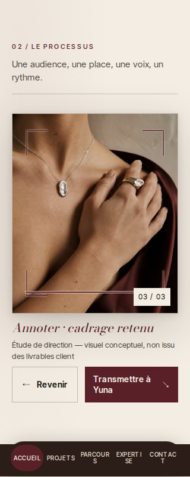](docs/previews/iphone-320-edit.png)
[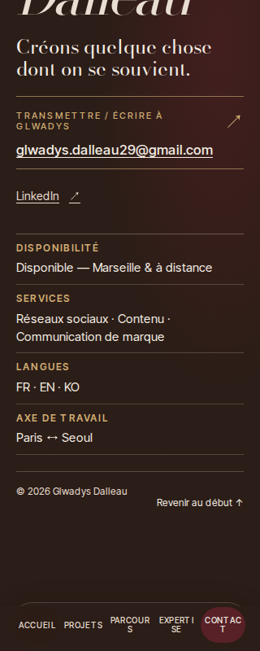](docs/previews/iphone-320-contact.png)

## Animations et QA

Le site utilise **Next.js 16 / React 19 / GSAP Flip + ScrollTrigger**, sans remplacement du scroll natif et sans WebGL global. L'interaction `THE EDIT` garde le même visuel entre téléphone, planche contact et sélection, puis le transmet à Yuna. Le mode « réduire les animations » dispose d'un chemin alternatif.

Le dernier test de production locale a enregistré **191 assertions satisfaites et 0 échec** en Chromium, ainsi qu'une validation typecheck, lint, build et diff. Cela ne remplace **ni un jury artistique, ni un contrôle réel sur iPhone/Safari**.

Les sources de preuve et le détail des limites sont consignés dans [le rapport V14](docs/flagship-audit/14-builder-results.md). Les médias de preuve complets (captures intermédiaires, traces et vidéos) sont conservés dans l'environnement QA du projet ; les images essentielles sont copiées dans `docs/previews/` pour être lisibles directement sur GitHub.

## Lancer le projet en local

```bash
npm ci
npm run dev
```

Ouvrir `http://localhost:3000/fr`. Autres langues : `/en`, `/ko`.

Vérifications :

```bash
npm run typecheck
npm run lint
npm run build
```

## Critère de validation finale

La mention « validé / 100 % » ne sera ajoutée **qu'après revue indépendante des images réelles**, navigation mobile/desktop, transitions réversibles, accessibilité, stabilité et performance. Les visuels d'étude conceptuelle ne sont pas présentés comme des livrables client.
