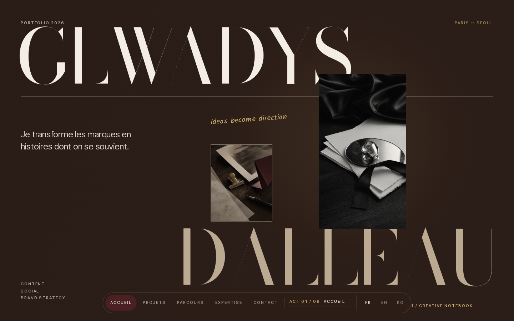
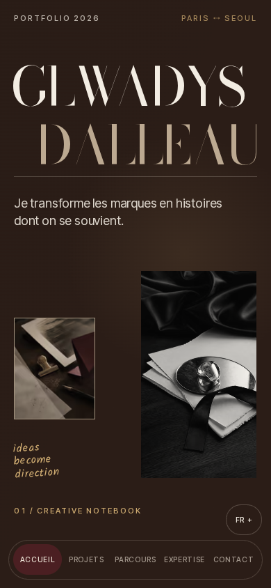
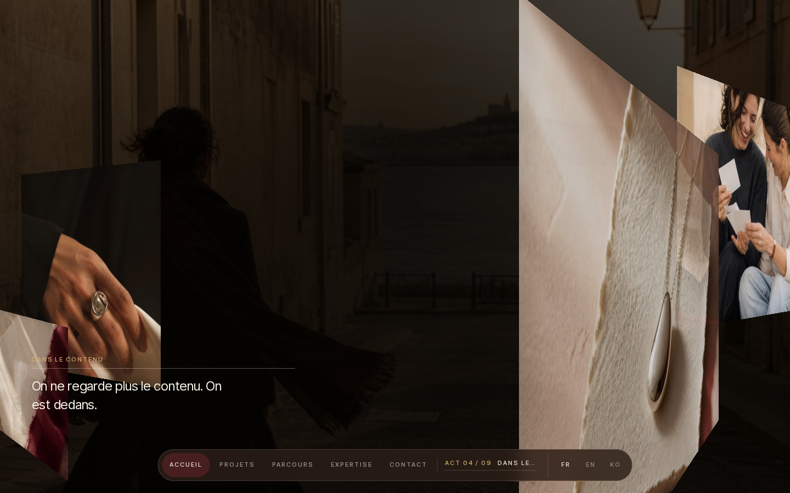
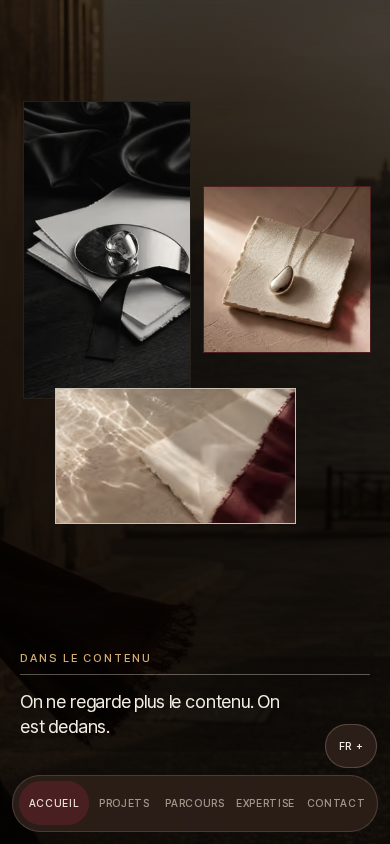
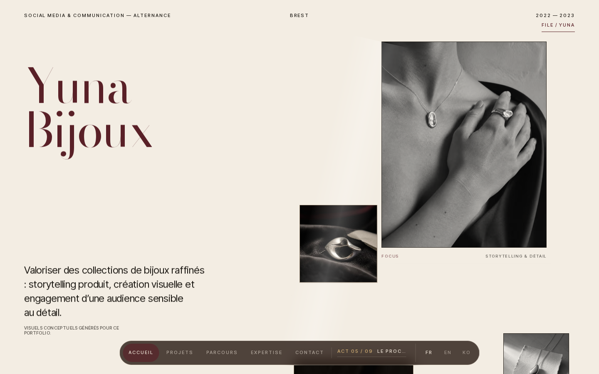

# Portfolio Glwadys — ORIGINAL FIRST / Flagship Awwwards

**Statut : V1 candidate — base originale conservée · refonte cinématique en cours, jury final NON VALIDÉ.**
Cette branche est issue directement du site créé avant Jarvis, commit `d4fefe2`. Elle conserve son storyboard en neuf actes, l'ouverture typographique cinématique, les animations GSAP, Three.js et les contenus originaux. Ce n'est **pas** une nouvelle vitrine générique.

> La refonte précédente `jarvis/awwwards-rebuild` reste disponible à titre comparatif ; cette branche `jarvis/glwadys-original-flagship` est celle qui garde la base créée par le propriétaire.

## Revoir les anciennes animations en vrai

| Desktop | Mobile |
| --- | --- |
|  |  |
|  |  |

**Vidéos réelles :** [animation originale desktop](docs/legacy-motion/desktop-legacy-session.webm) · [animation originale mobile](docs/legacy-motion/mobile-legacy-session.webm).

Certaines photos de l'ancienne scène restaient au-dessus des textes. Elles servent de référence pour sauver le mouvement **sans reproduire les bugs** : [défaut desktop](docs/legacy-motion/desktop-scroll-08.png) · [défaut mobile](docs/legacy-motion/mobile-scroll-08.png).

## Mission en cours

[Lire le cahier des charges ORIGINAL FIRST](docs/flagship/00-original-first-mission.md).

**Production :** GPT-6.1 Sol MAX (Codex via abonnement ChatGPT). **Jury indépendant :** GPT-6 Astra MAX. Préservation du récit initial, amélioration GSAP/Three.js, mobile composé séparément, performance, accessibilité et preuves visuelles. Aucun modèle ne doit s'autoattribuer un « 10/10 ».

Les captures de la prochaine version seront publiées ici après vérification. Aucun déploiement public ni modification de `main`.

## V1 — aperçu du travail en cours (8 octobre 2026)

Les captures ci-dessous proviennent du vrai site V1 dans Chromium, pas d'images conceptuelles. **Attention : elles ont été prises pendant la passe de développement (09:33–09:41), avant les derniers ajustements. Ce n'est pas encore la galerie de validation finale.**

| Moment | Desktop 1440×900 | Mobile 390×844 |
| --- | --- | --- |
| Ouverture originale sublimée |  |  |
| Profondeur et plans 3D |  |  |
| Yuna / dossiers |  |  |

**320px :** [ouverture](docs/previews/v1/mobile320-01-opening.png) · [téléphone Feed](docs/previews/v1/mobile320-04-phone-feed.png) · [Contact](docs/previews/v1/mobile320-18-contact.png). **Desktop :** [téléphone Feed](docs/previews/v1/desktop-04-phone-feed.png).

**QA V1 :** typecheck, lint et build passent ; 630/640 contrôles Playwright positifs, **10 écarts ou contrôles non concluants** à résoudre. La scène 3D est désormais bornée au chapitre Immersion et le mobile utilise une profondeur DOM. Restent notamment le chevauchement du bouton langue sur le rail du téléphone, l'indicateur de navigation, le nettoyage du Canvas après resize et la validation EN complète.

[Revue technique et visuelle honnête](docs/flagship/02-build-and-visual-review.md) · [Brief de correction V2](docs/flagship/04-next-sol-brief.md) · [Carte de préservation des neuf actes](docs/flagship/01-preservation-map.md).

**Pas de 10/10 annoncé, pas de jury Astra final, pas de vidéo V1 validée et aucun déploiement public.** Les WebM ci-dessus restent les enregistrements du site d'origine.
