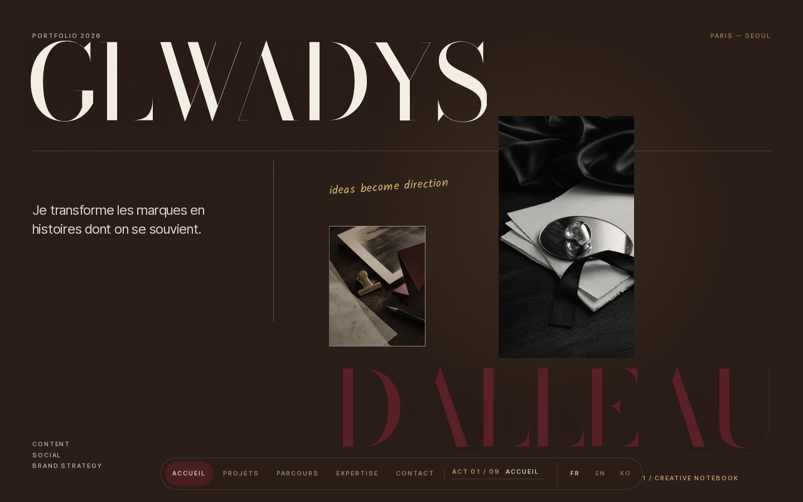
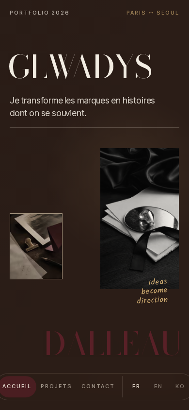
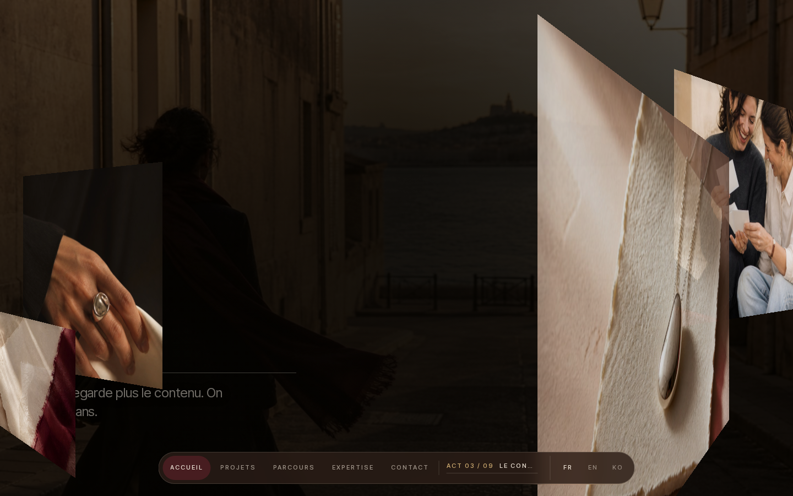
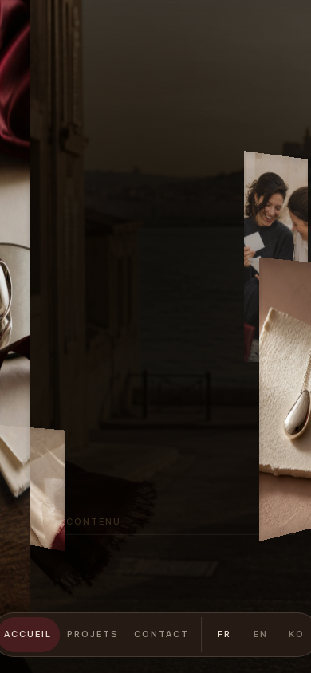
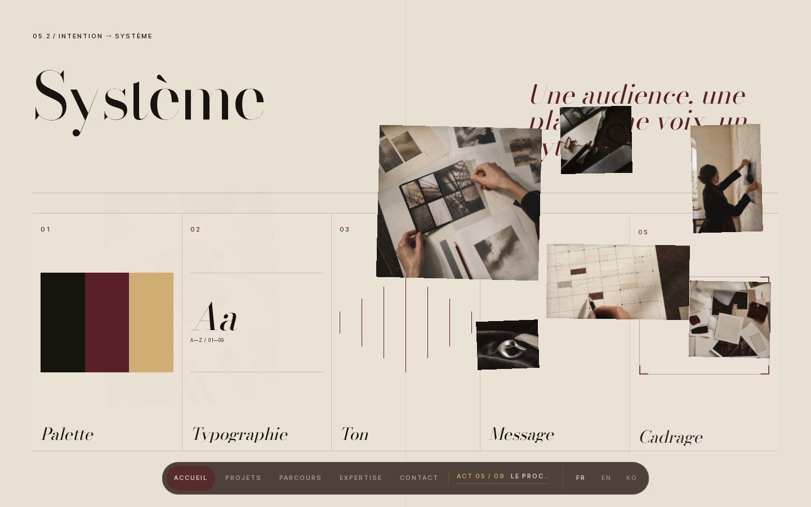
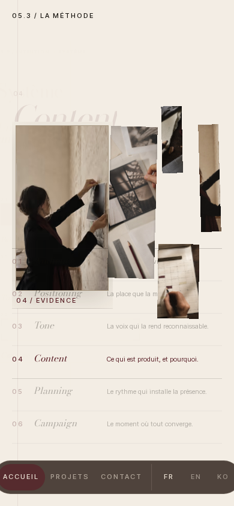

# 16 — Audit comparatif des animations AVANT Jarvis

**Source historique :** `origin/main` — commit `d4fefe2` (avant refonte).
**Candidat comparé :** `jarvis/awwwards-rebuild` V14 — commit `badac8c`.
**Preuve :** application historique servie indépendamment sur localhost:4420, Playwright Chromium 151, desktop 1440×900 et mobile 390×844, ouverture à 0,5 s / 3,1 s, 21 positions de scroll par format, reverse scroll, captures et enregistrements.

**Verdict :** la version d'origine possède une narration cinématique et des ambitions de mise en scène très supérieures à une succession de sections statiques. Mais elle présente une rémanence visuelle grave : une grappe de photos flottantes traverse plusieurs chapitres et masque le texte, notamment sur mobile. Il faut réutiliser ses **idées de mouvement**, jamais restaurer ses anciens composants 3D/GSAP sans correction.

## Les vraies animations à sauver

1. **Opening typographique à deux temps** — le nom commence composé/masqué, puis devient un titre monumental et un plateau photographique en plusieurs strates. Repères : [début](../legacy-motion/desktop-opening-0500ms.png), [après ouverture](../legacy-motion/desktop-opening-3100ms.png), [mobile](../legacy-motion/mobile-opening-3100ms.png). Recommandation : revoir l'ouverture V14 pour réintroduire **l'échelle, le masque et le montage photographique** sur un geste court (sans verrouillage obligatoire du scroll, avec reduced-motion et skip).
2. **Téléphone / contenu mis en scène** — avant Jarvis, ACT03 créait une forme de film de contenus : Feed → Focus → Story → Campagne dans un téléphone central ([capture desktop](../legacy-motion/desktop-scroll-03.png)). Recommandation : intégrer ce langage de montage à la narration `THE EDIT` existante, mais conserver **l'unique image source persistante V14** qui se transmet correctement jusqu'à Yuna. Ne pas remettre une longue démo UI supplémentaire.
3. **Front → Behind / profondeur** — images encadrées, premier plan et arrière-plan, variations de perspective et de cadrage. Rendre le moment rare et lisible plutôt que créer de la profondeur permanente. L'ancien [passage desktop](../legacy-motion/desktop-scroll-05.png) a le potentiel, mais le rendu observé couvre du texte.
4. **Preuves → Moodboard → Système** — sensation d'un studio qui transforme la matière en choix éditorial : rail, contact sheet, planification, typographie, campagne. Recommandation : une séquence réduite et plus forte, animée par ScrollTrigger + GSAP Flip, plutôt qu'une cascade de panneaux.
5. **Raccords physiques entre les actes** — l'intention était que la sortie de chaque chapitre engendre la première image du suivant. Continuer cette idée dans le **handoff V14 vers Yuna**, déjà mieux réalisé techniquement, et concevoir un second raccord marquant de Yuna vers MGC / dossier vers frise Parcours.
6. **Parcours animé avec playhead** — préserver une seule progression active pilotée par le scroll ; V14 dispose déjà d'une version plus sobre et plus sûre, inutile de restaurer tout l'ancien pin.

## Ce qu'il ne faut pas réinstaller

| Défaut observé | Preuve / impact | Politique |
| --- | --- | --- |
| Grappe de photos en rémanence | [Ancien système desktop](../legacy-motion/desktop-scroll-08.png), [sur les projets](../legacy-motion/desktop-scroll-14.png), [mobile sur la méthode](../legacy-motion/mobile-scroll-08.png), [mobile dans MGC](../legacy-motion/mobile-scroll-12.png) | Interdit : les médias doivent quitter l'écran à la fin de leur acte. Le texte et les CTAs passent toujours devant. |
| Canvas 3D persistant | Un canvas apparaît après le démarrage de la phase scène et reste à travers les sections, y compris sur mobile. | N'autoriser un WebGL local que si un **nouveau** prototype montre un bénéfice supérieur à CSS/Flip et qu'il s'éteint/cleanup immédiatement. |
| Warnings runtime | En version originale, avertissements THREE.Clock, logs StagePlane/texture et un message de stall GPU ReadPixels ; pas d'exception JavaScript capturée. | Ne restaurer ni les logs de prod ni le pipeline WebGL tel quel. |
| Parcours extrêmement long | ~28 088 px desktop, ~23 967 px mobile après intro, au viewport testé. | Préserver la cinématographie avec un rythme plus resserré ; pas de galerie de pins interminable, surtout au toucher. |
| Navigation mobile réduite | L'ancien mobile n'affichait directement que Accueil / Projets / Contact ; actuel V14 affiche les cinq destinations. | Conserver l'accès mobile aux cinq rubriques. |
| Images recouvrant des textes | [Méthode desktop](../legacy-motion/desktop-scroll-08.png) et [Méthode mobile](../legacy-motion/mobile-scroll-08.png). | Le mouvement est refusé si un état du scroll masque un paragraphe, une image probante ou un bouton. |

## Galeries et recordings originaux

Ces fichiers sont de **vrais rendus de la version d'origine**, capturés par Chromium, pas des concept arts. Les enregistrements montrent un parcours automatisé par positions de scroll et par molette : ils servent de preuve de séquence, **pas de mesure de fluidité d'un utilisateur réel**.

- [Voir l'enregistrement desktop d'avant Jarvis](../legacy-motion/desktop-legacy-session.webm)
- [Voir l'enregistrement mobile d'avant Jarvis](../legacy-motion/mobile-legacy-session.webm)

| Moment d'origine | Desktop | Mobile |
| --- | --- | --- |
| Opening scénarisé |  |  |
| Profondeur / chapitre |  |  |
| Photos au-dessus du contenu, exemple à corriger |  |  |

## Contrat d'implémentation V15 — restituer le spectacle sans les bugs

Le designer/builder doit **lire et regarder les preuves ci-dessus AVANT de modifier le site**.

- **P0** : reproduire l'énergie/échelle/cadence de l'ancien Opening, avec la qualité typographique et la clarté mobile V14. Le résultat final doit être distinctif dès **une image fixe**.
- **P0** : conserver l'excellent principe `THE EDIT` V14 (même photographie, GSAP Flip, réel handoff). Le mouvement doit sentir le montage d'une campagne, pas trois clics de prototype.
- **P1** : un geste de profondeur contrôlé (pas le vieux chaos de photos) qui quitte le DOM/visuel à la sortie de son chapitre, sans aucune image devant texte.
- **P1** : une transition mémorable entre les cas/projets **qui matérialise une décision** ; un autre geste signé en fin de Contact.
- **P0 mobile** : écran 390×844 ET 320×800 distinctement composés, texte jamais masqué, gestes tactiles/focus, cinq destinations, dock hors des contrôles.
- **P0 technique** : navigation reverse/rapide, refresh milieu de scroll, réduit, clavier, FR/EN/KO, console clean, stabilité et budget de performance.

**Interdiction** de revenir au composant `StageLayer/StageScene` d'origine et à ses photos flottantes sans une nouvelle architecture et une preuve visuelle/technique convaincantes. Ne pas réintroduire par réflexe Lenis + pins multiples + canvas global.

## Séparation travail / validation

- La V14 a ses images actuelles dans [la galerie GitHub](../../README.md#galerie-desktop-et-mobile).
- Le jury Astra V14 est distinct et doit rendre son verdict ; cet audit de l'historique ne constitue pas un « 100 % Awwwards ».
- Le prochain unique builder Sol max fait une passe ciblée **après lecture des deux audits** ; un jury indépendant vérifie toutes les nouvelles captures et les reverses au scroll.
- Publier les nouvelles captures dans le README uniquement si elles sont plus fortes et vérifiées. Ne pas toucher `main` ni déployer publiquement.
